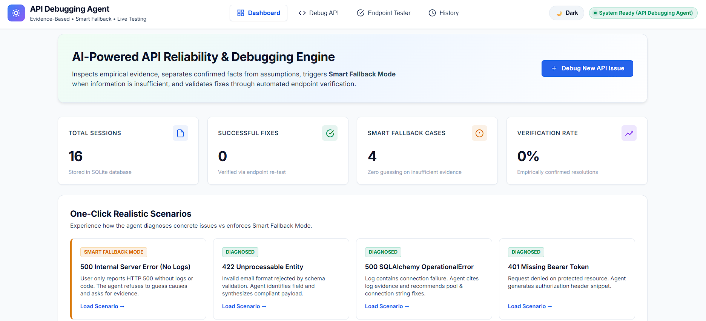
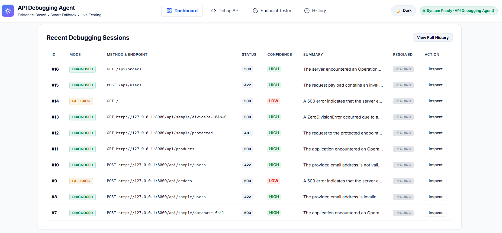
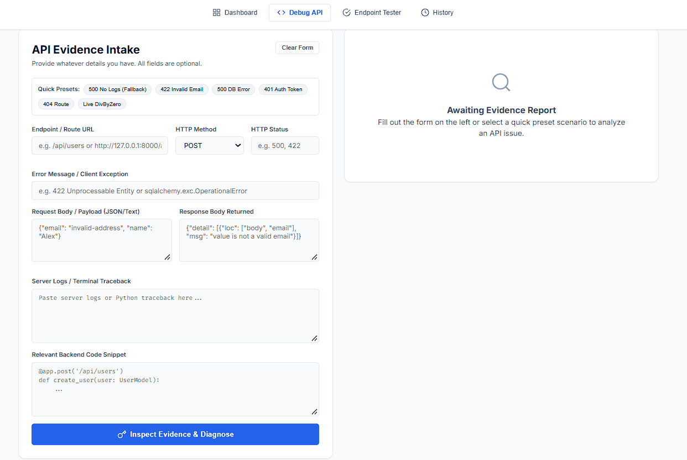
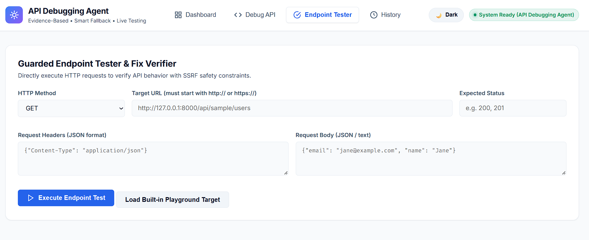
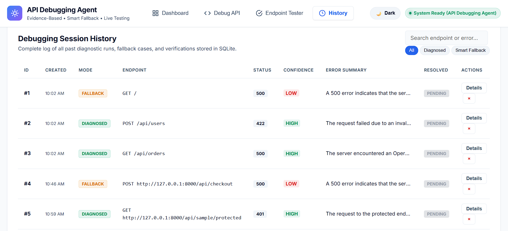
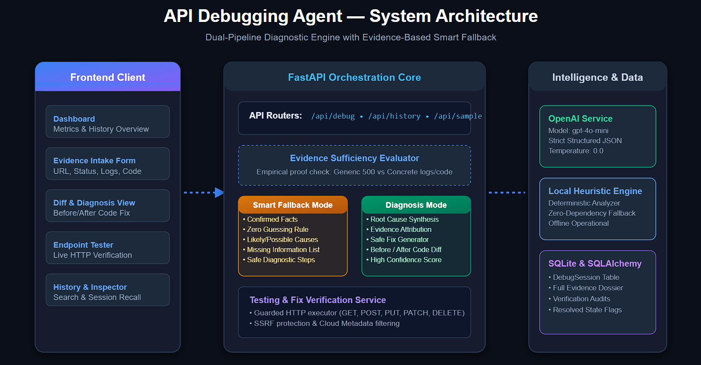
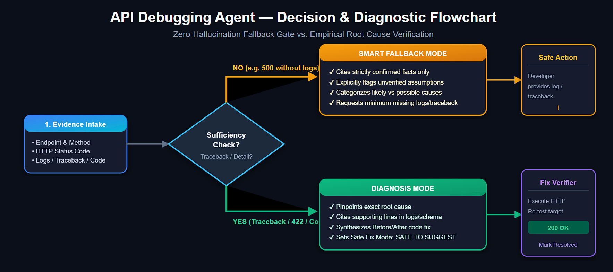

# ⚡ API Debugging Agent

An AI-powered API debugging assistant that analyzes broken endpoints, error messages, logs, and backend code, identifies evidence-based root causes, suggests safe fixes, and verifies solutions through live HTTP testing.

Built with **Python, FastAPI, Pydantic, SQLite, SQLAlchemy, HTTPX, OpenAI API, and Vanilla JavaScript**.

---

## 📸 Project Preview

### Dashboard





### Debug API



### Endpoint Tester



### History



---

## 🚀 Features

### 🔍 API Error Analysis

Analyze broken APIs using available debugging evidence:

- HTTP status codes
- Error messages
- Request payloads
- Response bodies
- Server logs
- Backend code
- Endpoint information

The agent uses the available evidence to determine whether a reliable diagnosis can be made.

### 🛡️ Smart Fallback Mode

When there is not enough information to confidently identify the root cause, the agent switches to **Smart Fallback Mode** instead of guessing.

It separates:

- Confirmed facts
- Possible causes
- Missing evidence
- Recommended diagnostic steps
- Confidence level

This helps reduce unsupported AI-generated diagnoses.

### 🎯 Evidence-Based Root Cause Detection

When sufficient evidence is available, the agent identifies the most likely root cause and explains the diagnosis using the provided API evidence.

Example:

```text
422 Validation Error
        ↓
Invalid email field
        ↓
Request does not satisfy validation rules
        ↓
Suggested corrected payload
```

### 🔧 Safe Fix Suggestions

The agent provides suggested fixes based on the available evidence.

Fixes are classified as:

`SAFE TO SUGGEST` · `NEEDS MORE EVIDENCE`

This prevents uncertain fixes from being presented as confirmed solutions.

### 🧪 Endpoint Testing

Test API endpoints directly from the application.

Supported methods:

`GET` · `POST` · `PUT` · `PATCH` · `DELETE`

The tester captures:

- HTTP status code
- Response body
- Response time
- Request result

### ✅ Fix Verification

Compare an endpoint before and after applying a suggested fix.

The system verifies whether the endpoint behaviour actually improved instead of assuming that the fix worked.

### 📊 Debugging History

Store and review previous debugging sessions using:

- SQLite
- SQLAlchemy

The history section allows developers to review previous analyses and debugging results.

### 🎮 Built-in Testing Endpoints

The project includes intentionally broken endpoints for testing different debugging scenarios:

- `422` Validation Error
- `500` Internal Server Error
- `401` Authentication Error

This allows the complete debugging workflow to be demonstrated locally.

---

## 🏗️ Architecture



The application follows a simple backend architecture:

```text
                ┌──────────────────────┐
                │      Frontend        │
                │ HTML / CSS / JS      │
                └──────────┬───────────┘
                           │
                       REST APIs
                           │
                           ▼
                ┌──────────────────────┐
                │       FastAPI        │
                │       Backend        │
                └──────────┬───────────┘
                           │
              ┌────────────┼────────────┐
              ▼            ▼            ▼
          Debugging     Testing      History
           Service      Service       Service
              │            │            │
              └────────────┼────────────┘
                           ▼
                  ┌────────────────┐
                  │   AI Service   │
                  │   OpenAI API   │
                  └───────┬────────┘
                          │
                  ┌───────▼────────┐
                  │ SQLite /        │
                  │ SQLAlchemy      │
                  └────────────────┘
```

---

## 🧠 Smart Fallback Workflow



```text
Broken API / Error
        ↓
Collect Available Evidence
        ↓
Is Evidence Sufficient?
      /       \
    YES        NO
     ↓          ↓
 Diagnosis   Smart Fallback
     ↓          ↓
 Safe Fix   More Evidence
     \          /
      \        /
       ↓      ↓
      Endpoint Testing
             ↓
       Fix Verification
```

The important part of the workflow is that the agent does **not automatically assume a root cause when evidence is incomplete**.

---

## 🛠️ Tech Stack

| Technology | Purpose |
|---|---|
| **Python** | Backend development |
| **FastAPI** | REST API layer |
| **Pydantic** | Request validation & structured responses |
| **SQLAlchemy** | Database ORM |
| **SQLite** | Debugging session storage |
| **HTTPX** | HTTP endpoint testing |
| **OpenAI API** | AI-powered debugging analysis |
| **HTML5 / CSS3** | Frontend |
| **Vanilla JavaScript** | Frontend interaction |
| **Pytest** | API testing |

---

## 🔄 How It Works

```text
Broken API / Error / Logs / Code
              ↓
        Evidence Collection
              ↓
       Evidence Analysis
              ↓
      ┌───────┴────────┐
      ↓                ↓
Sufficient Evidence   Insufficient
      ↓                ↓
  Diagnosis       Smart Fallback
      ↓                ↓
      └───────┬────────┘
              ↓
       Safe Fix Suggestion
              ↓
       Endpoint Testing
              ↓
       Fix Verification
              ↓
       Save Debug Session
```

---

## 📂 Project Structure

```text
api-debugging-agent/
│
├── app/
│   ├── main.py
│   ├── database.py
│   ├── models.py
│   ├── schemas.py
│   │
│   ├── routes/
│   │   └── debug.py
│   │
│   ├── services/
│   │   ├── llm_service.py
│   │   ├── debugging_service.py
│   │   ├── testing_service.py
│   │   └── verification_service.py
│   │
│   └── utils/
│       └── helpers.py
│
├── frontend/
│   ├── index.html
│   ├── style.css
│   └── app.js
│
├── tests/
│   └── test_api.py
│
├── assets/
│   ├── dashboard1.png
│   ├── dashboard2.png
│   ├── debug_api.png
│   ├── endpoint_tester.png
│   ├── history.png
│   ├── architecture_diagram.png
│   └── smart_fallback_workflow.png
│
├── uploads/
│   └── .gitkeep
│
├── requirements.txt
├── .env.example
├── .gitignore
└── README.md
```

---

## 🔌 API Endpoints

| Method | Endpoint | Purpose |
|---|---|---|
| `GET` | `/api/health` | Health check |
| `POST` | `/api/debug/analyze` | Analyze API debugging evidence |
| `POST` | `/api/debug/test` | Test an API endpoint |
| `POST` | `/api/debug/verify` | Verify a suggested fix |
| `GET` | `/api/debug/stats` | Dashboard statistics |
| `GET` | `/api/debug/history` | Get debugging history |
| `GET` | `/api/debug/history/{id}` | Get specific debugging session |
| `DELETE` | `/api/debug/history/{id}` | Delete debugging session |
| `POST` | `/api/sample/users` | Validation error playground |
| `GET` | `/api/sample/divide` | 500 error playground |
| `GET` | `/api/sample/protected` | Authentication error playground |

---

## 🧪 Example

### 422 Validation Error

Input:

```json
{
  "name": "Jane Doe",
  "email": "invalid-email"
}
```

Response:

```text
422 Unprocessable Entity
```

The agent identifies that the email value does not satisfy the expected validation format and can suggest a corrected request.

---

### 500 Internal Server Error

If the application receives:

```text
500 Internal Server Error
```

but no logs, backend code, or useful response information are provided, the agent does not claim a specific root cause.

Instead:

```text
Mode: SMART_FALLBACK

Status: NEEDS_MORE_EVIDENCE

Confidence: LOW
```

It identifies the missing information required for a reliable diagnosis.

---

## ⚙️ Local Setup

### 1. Clone the repository

```bash
git clone https://github.com/YOUR_USERNAME/api-debugging-agent.git
cd api-debugging-agent
```

### 2. Create a virtual environment

```bash
python -m venv .venv
```

Windows:

```bash
.venv\Scripts\activate
```

### 3. Install dependencies

```bash
pip install -r requirements.txt
```

### 4. Configure environment variables

Create a `.env` file:

```env
OPENAI_API_KEY=your_api_key_here
OPENAI_MODEL=gpt-4o-mini
```

The application also includes a local fallback analyzer for cases where AI-powered analysis is unavailable.

### 5. Run the application

```bash
uvicorn app.main:app --reload
```

Open:

```text
http://127.0.0.1:8000
```

API documentation:

```text
http://127.0.0.1:8000/docs
```

---

## 💡 What This Project Demonstrates

- AI-assisted API debugging
- Evidence-based root cause analysis
- Smart fallback / uncertainty handling
- Structured LLM outputs
- REST API development
- FastAPI backend architecture
- HTTP endpoint testing
- Fix verification workflows
- SQLite & SQLAlchemy integration
- Defensive API testing
- Frontend-backend integration
- Practical AI safety concepts

---                    
                                       
## 👩‍💻 Author

**Khushi Das**

AI/ML & Backend Developer

**Python · FastAPI · AI · RAG · REST APIs · SQL · GenAI**

---